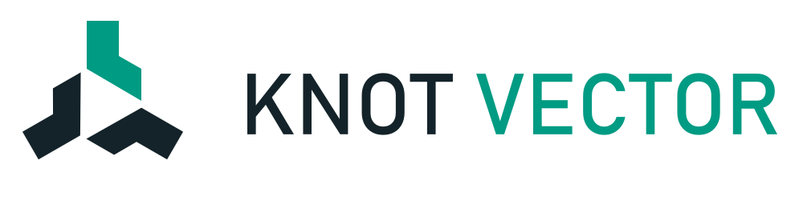
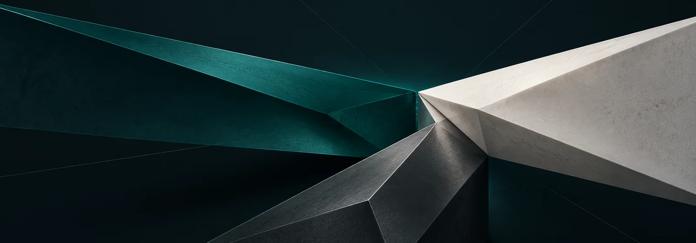
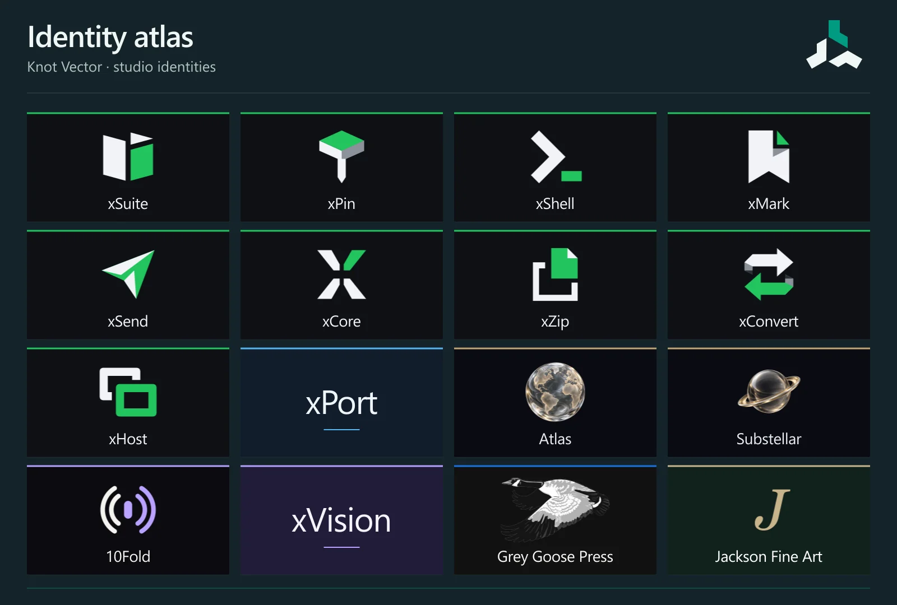
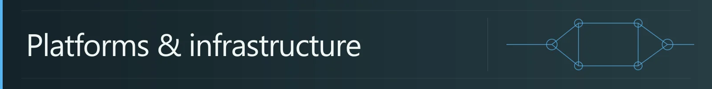
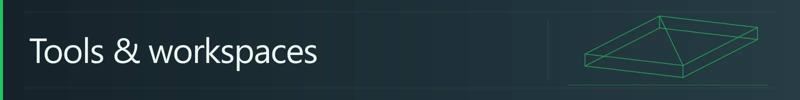
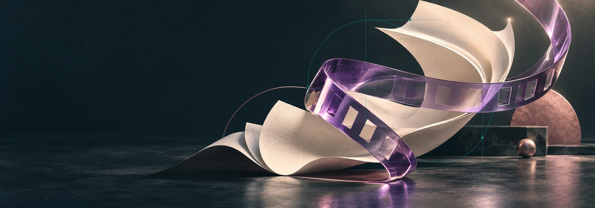
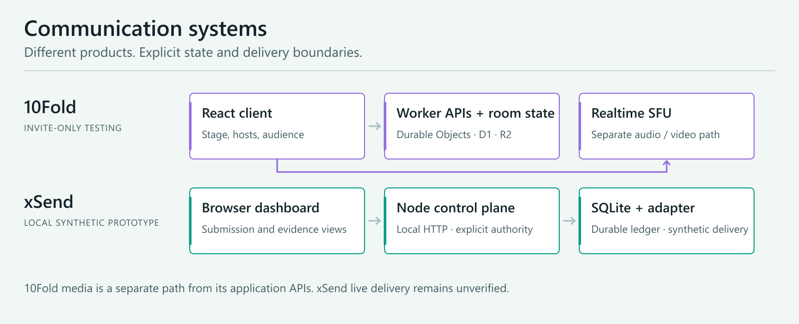
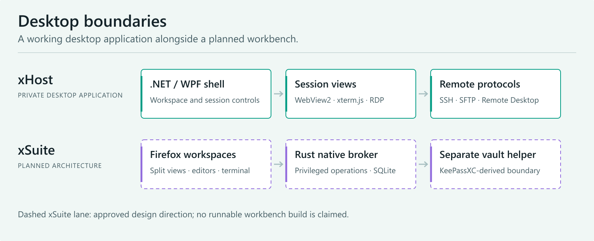
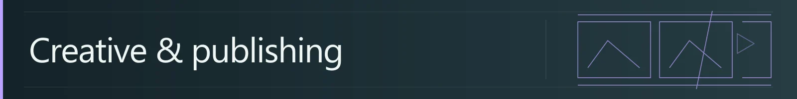

<picture>
  <source media="(prefers-color-scheme: dark)" srcset="assets/knot-vector-on-dark.svg">
  
</picture>

# Thoughtful tools. Connected systems.

**An independent studio at the meeting point of product design, software engineering, and creative production.**

Knot Vector brings product design and engineering together to build digital tools, connected workspaces, and creative software. The work spans live communication, Windows utilities, maps, game worlds, publishing, and moving images. Each project has its own identity and purpose; a shared attention to systems, interfaces, and craft connects the collection.

[Project directory](#project-directory) · [Architecture](#architecture) · [Technology](#technology) · [Working practice](#working-practice) · [Archive](#archive)

## Project directory

**22 named projects and identities.** The directory includes software in development, working private tools, exploratory directions, connected client work, and a preserved archive. Development stages describe the work rather than promise a public release. Knot Lab belongs to Knot Vector; World Atlas and GeoIndex are one evolving geography project.

<picture>
  <source media="(max-width: 600px)" srcset="assets/catalog-mobile.webp">
  
</picture>

### Platforms and infrastructure

Communication products and the systems beneath them: room state, durable records, visible outcomes, and boundaries that can be understood.

| Project | Focus | Stage |
| :-- | :-- | :-- |
| **10Fold** | Live social audio and video around a ten-seat stage, hosts, audience conversation, and participation. | Invite-only testing |
| **xSend** | Transactional email infrastructure centered on durable submissions, delivery evidence, and explicit recovery behavior. Current proof is synthetic and local; live delivery remains unverified. | Local prototype |
| **xCore** | An approved Aperture identity for a product direction whose application scope has not been published. Separate from the xSend backend. | Identity direction |

### Desktop and productivity

Windows is a recurring workshop: arranging tools around a task, moving between machines, working with local files, and making everyday utilities feel considered. Shared visual language does not imply a shared runtime or completed integration.

| Project | Focus | Stage |
| :-- | :-- | :-- |
| **xSuite** | A planned Windows workbench for browsing, documents, code, terminals, and a password vault in nested split views. No runnable build yet. | Foundation in progress |
| **xHost** | A Windows control center for remote desktops, terminals, files, transfers, and server health. | Private desktop application |
| **xPort** | Custom icons and Start Menu/Search access for portable Windows applications. No published software release. | Alpha development |
| **xMeter** | A private Windows workspace concept for understanding authorized resources, allowances, and evidence. Real collection and installed runtime remain to be verified. | Owner preview |
| **xShell** | Shell and terminal workflows, with an approved Prompt identity. | Product direction |
| **xMark** | Markdown writing with the result in view, with an approved Foldmark identity. | Product direction |
| **xPin** | Portable EXE icons and standard Windows Start Menu shortcuts, with an approved Foldpin identity. | Product direction |

### Worlds and exploration

Maps and game worlds turn information into places to explore. This work ranges from sourced geography and fan mapping to a Fabric-based game and the tools imagined around it.

| Project | Focus | Stage |
| :-- | :-- | :-- |
| **World Atlas / GeoIndex** | An immersive geography explorer connecting maps, sourced topics, and place comparisons. The Atlas/GeoIndex direction is one project. | Local development |
| **Substellar** | A Minecraft overhaul connecting a Fabric game, dedicated Windows launcher, and website. | Local Fabric development |
| **Project Vanilla** | A Minecraft community website with procedural voxel landscapes and Survival/Creative perspectives. | Community web experience |
| **Waypoint-VI** | An unofficial Leonida fan atlas with aligned map styles and place discovery. | Map prototype |
| **Voxel Compose** | A planned Minecraft creation studio connecting references, editable assets, changes, and in-game review. Substellar is a feasibility target. | Design and integration planning |

### Creative and publishing

Creative work has a production side: references, editorial structure, asset handling, timelines, exports, and handover. The studio also contributes brand and web work to independent publishing and art projects, which retain their own identities.

| Project | Focus | Stage |
| :-- | :-- | :-- |
| **xVision** | Tools and workflows for references, moving-footage editing, export inspection, and reproducible video projects. | Private development |
| **xConvert** | A web-based file-conversion direction with the approved Foldback identity; application availability is not established. | Product direction |
| **Brand Library** | A local Windows identity and asset library with an image browser, exact downloads, source provenance, and preserved design history. | Internal studio tool |
| **Grey Goose Press** | Independent publishing, book storefronts, and the web systems around a publishing house. | Connected publishing work |
| **Jackson Fine Art** | An art-focused identity and web presentation with a forest, gold, and warm-paper visual language. | Connected brand and web work |

### The studio itself

**Knot Vector / Knot Lab** is the evolving interactive studio: a place for project constellations, creative worlds, and development stories. **Brand Library** supports the work behind the scenes with preserved identities, source-aware assets, and an image browser.

## Architecture

The systems below are project-specific. Solid diagrams describe implemented code paths; the xSuite lane is explicitly a planned architecture. Prototype and testing stages remain attached to the projects.

### Communication systems

<picture>
  <source media="(max-width: 600px) and (prefers-color-scheme: dark)" srcset="assets/architecture-platforms-mobile-dark.png">
  <source media="(max-width: 600px)" srcset="assets/architecture-platforms-mobile-light.png">
  <source media="(prefers-color-scheme: dark)" srcset="assets/architecture-platforms-dark.png">
  
</picture>

| System | Application boundary | State and execution | Current evidence |
| :-- | :-- | :-- | :-- |
| **10Fold** | React client; Worker APIs | Durable Object room state; D1 accounts; R2 avatars; Realtime SFU media | Invite-only testing. Payment-like gift and wallet balances use simulated Test mode. |
| **xSend** | Local browser dashboard and Node HTTP/control plane | SQLite submission and evidence ledger; synthetic adapter | Local synthetic prototype. Live provider and hosted acceptance remain unverified. |

### Desktop boundaries

<picture>
  <source media="(max-width: 600px) and (prefers-color-scheme: dark)" srcset="assets/architecture-desktop-mobile-dark.png">
  <source media="(max-width: 600px)" srcset="assets/architecture-desktop-mobile-light.png">
  <source media="(prefers-color-scheme: dark)" srcset="assets/architecture-desktop-dark.png">
  
</picture>

| Project | Architecture | Stage |
| :-- | :-- | :-- |
| **xHost** | .NET/WPF shell, WebView2 and xterm.js views, SSH/SFTP, and Windows Remote Desktop | Private desktop application |
| **xSuite** | Planned Firefox ESR application, CodeMirror and xterm.js views, Rust broker, SQLite metadata, and a KeePassXC-derived vault helper | Foundation; application unbuilt |
| **xPort** | WinUI 3 / Windows App SDK, with an MSIX packaging direction | Alpha development |
| **Brand Library** | Windows host and WebView2, a loopback catalog, local assets, maintained sources, and packaged exports | Internal studio tool |

### Creation and world building

| Project | Shape of the system | Architectural focus |
| :-- | :-- | :-- |
| **xVision** | Python CLI → JSON project and frame-based timeline → FFmpeg/ffprobe → reviewed exports and package | Reproducible creative production; an optional separate Kling adapter |
| **Substellar** | Fabric game + dedicated Windows launcher + website | Clear boundaries between the game, delivery, and presentation |
| **World Atlas** | Map experience + sourced topic data + comparison/export views | Source provenance and geography that stays useful beyond the visualization |
| **Voxel Compose** | References → editable assets → changes → in-game review | Design and feasibility planning; Substellar is the first target to investigate |

## Technology

Tools are selected per project and per constraint. This is a view across the collection, not a claim that every product uses the same stack.

| Area | Technologies in the work | Used for |
| :-- | :-- | :-- |
| **Edge and realtime** | Cloudflare Workers, Durable Objects, D1, R2, Realtime SFU | APIs, room coordination, application records, assets, media |
| **Windows and native** | .NET/WPF, WinUI 3, WebView2, SSH/SFTP, RDP | Desktop shells, remote sessions, portable-app utilities |
| **Desktop research** | Firefox ESR, Rust, CodeMirror, xterm.js, KeePassXC-derived components | Planned xSuite application boundaries |
| **Data and tooling** | SQLite, TypeScript, JavaScript, Python, JSON | Local records, explicit contracts, scripts, portable project formats |
| **Media and worlds** | FFmpeg/ffprobe, Fabric, native SVG, raster artwork | Moving footage, game development, precise identities, visual systems |

## Working practice

**Design around the task.** Begin with the experience, define the important actions, and build a visual language that makes related tools feel coherent. Preserve strong identities rather than flattening every product into the same template.

**Make boundaries visible.** Distinguish the interface, application authority, durable state, and external services. A design relationship is different from a runtime dependency; an adapter is different from a verified integration.

**Keep evidence with the work.** Use builds, tests, direct inspection, and documented checks. Describe prototypes, planned capabilities, private tools, and retired services in their actual stages. Treat exports, source assets, and reproducible handovers as part of the product.

**Build for continuity.** Prefer maintainable sources, understandable formats, clear recovery paths, and tools that remain useful outside the original session.

## Archive

**xZip — Offline / retired.** A Google Drive-to-Drive ZIP extraction service. Its architecture combined a TypeScript Worker, SQLite-backed Durable Objects, a Python extraction Container, ranged archive reads, and resumable Drive uploads. The deployment was retired on **22 October 2026**; source and architectural work remain preserved.

---

*Independent projects. Shared attention to craft.*
