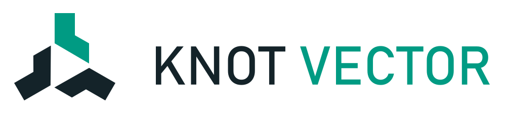
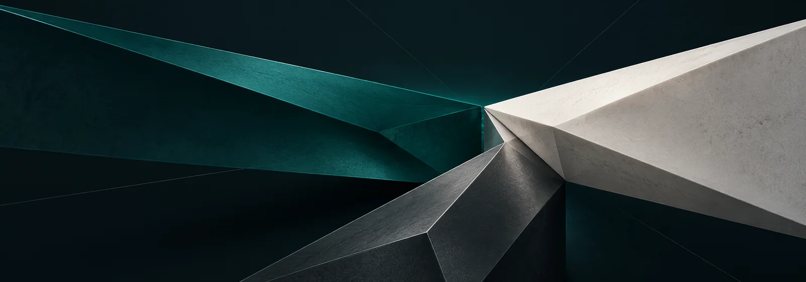

<picture>
  <source media="(prefers-color-scheme: dark)" srcset="assets/knot-vector-on-dark.svg">
  
</picture>

# Thoughtful tools. Connected systems.

**An independent studio at the meeting point of product design, software engineering, and creative production.**

Knot Vector brings product design and engineering together to build digital tools, connected workspaces, and creative software.
